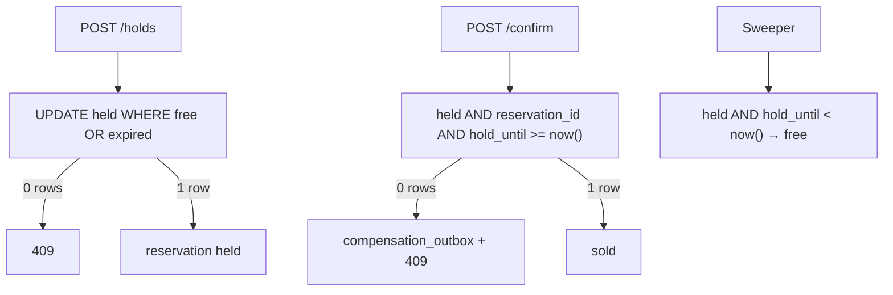

# booking-reservation

## Проблема

Бронь места (зал / рейс / слот) — классика system design: ресурс конечный, два клиента не должны получить одно место, а неоплаченный hold обязан отпуститься сам.

`fifo-waiting-room` только впускает человека в checkout. Здесь решается, **чьё место** на ближайшие N минут.

Наивное `SELECT status → UPDATE` даёт oversell: оба видят `free` и оба пишут `held`. Счётчик «осталось N» ещё и собирает все блокировки в одну горячую строку.

## Решение

Источник истины — **одна строка PostgreSQL на место**. Захват — один условный `UPDATE`, время — `now()` базы:

```sql
UPDATE seats
   SET status = 'held', holder_id = :user, reservation_id = :id,
       hold_until = now() + :ttl
 WHERE id = :seat
   AND (status = 'free'
        OR (status = 'held' AND hold_until < now()))
RETURNING *;
```

Ноль строк → `409`. Confirm и sweeper смотрят на непересекающиеся предикаты:



Главный край: оплата дольше TTL. A держит место, платёж идёт, hold истекает, B берёт место, confirm A не переписывает B — уходит в компенсацию (локальный outbox в той же tx).

`Idempotency-Key` на create/confirm — inline по контракту `idempotency-key` (без Gradle-зависимости; после merge стартера можно заменить).

## Модули

Один сервис: hold/confirm/sweeper, demo payment, inline idempotency, метрики.

## API (`:8230`)

```bash
# карта мест
curl -s localhost:8230/venues/hall-1/seats | jq

# hold (correct)
curl -s -X POST localhost:8230/holds \
  -H 'Content-Type: application/json' \
  -H 'Idempotency-Key: k-1' \
  -H 'Idempotency-Key-Owner: user-a' \
  -d '{"seatId":"last-1","userId":"user-a"}'

# naive hold (для сравнения oversell)
curl -s -X POST localhost:8230/naive/holds \
  -H 'Content-Type: application/json' \
  -d '{"seatId":"last-1","userId":"user-b"}'

# demo payment (можно замедлить)
curl -s -X POST localhost:8230/payments \
  -H 'Content-Type: application/json' \
  -d '{"reservationId":"<id>","delayMs":7000}'

# confirm
curl -s -X POST localhost:8230/reservations/<id>/confirm \
  -H 'Idempotency-Key: c-1' \
  -H 'Idempotency-Key-Owner: user-a'

# сброс зала для демо
curl -s -X POST localhost:8230/admin/venues/last-seat/reset
```

Venues: `hall-1` (4×5), `last-seat` (одно место `last-1` для race).

## Стек

- Kotlin / Java 21
- Spring Boot 3 (WebFlux, R2DBC)
- PostgreSQL
- Micrometer / Prometheus / Grafana
- Docker Compose / Gatling

## Запуск

```bash
./gradlew :booking-reservation:bootJar
cd booking-reservation && docker compose up --build
```

| Сервис | Порт |
|--------|------|
| API | 8230 |
| Postgres | 5438 |
| Prometheus | 9098 |
| Grafana | 3007 (`admin`/`admin`) |

## Gatling

```bash
# last seat, correct — ровно один 200
./gradlew :booking-reservation:scripts:gatling:gatlingRun \
  --simulation=com.andver.booking.gatling.LastSeatCorrectSimulation --non-interactive

# naive — oversell (ok > 1)
./gradlew :booking-reservation:scripts:gatling:gatlingRun \
  --simulation=com.andver.booking.gatling.LastSeatNaiveSimulation --non-interactive

# TTL release
./gradlew :booking-reservation:scripts:gatling:gatlingRun \
  --simulation=com.andver.booking.gatling.TtlReleaseSimulation --non-interactive

# late confirm → compensation
./gradlew :booking-reservation:scripts:gatling:gatlingRun \
  --simulation=com.andver.booking.gatling.LateConfirmSimulation --non-interactive
```

## Метрики / Grafana

- `booking_holds_ok`, `booking_hold_conflicts`
- `booking_confirms_ok`, `booking_confirm_conflicts`
- `booking_expired_releases`, `booking_compensations`
- `booking_oversell`, `booking_naive_holds_ok`
- `booking_idempotency_replayed`, `booking_idempotency_conflict`

Dashboard: http://localhost:3007 → **Booking Reservation**

## Граница

Не waiting room, не Redis lock, не счётчик мест, не Kafka-outbox engine. Компенсация — локальная таблица + лог/метрика. Idempotency inline до появления смерженного `idempotency-key` стартера.
