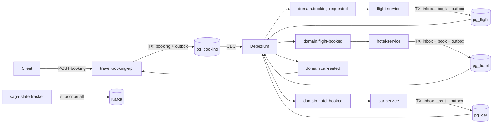
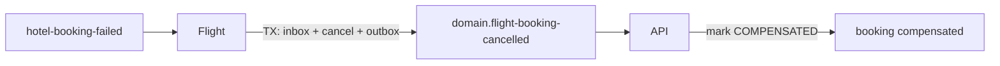

# choreography-saga

## Проблема

Распределённая бизнес-операция (бронирование путешествия) затрагивает несколько сервисов, у каждого — своя БД. Нет общей ACID-транзакции.

Уже реализованный [saga-orchestrator](../saga-orchestrator/README.md) решает это **центральным оркестратором** (command/reply + SEC). У choreography другой набор проблем:

- **Нет владельца процесса** — никто не хранит глобальный статус саги; при зависании на середине цепочки сложно понять, где остановились.
- **At-least-once доставка Kafka** — без идемпотентного consumer один и тот же `flight-booked` может забронировать отель дважды.
- **Outbox без inbox** — [transactional-outbox-engine](../transactional-outbox-engine/README.md) закрывает публикацию; недостающая половина — **дедоп входящего события в локальной TX** вместе с бизнес-изменением и следующим outbox-событием.
- **Компенсации** — откат идёт обратной цепочкой событий, а не командами от координатора; pivot (отель) должен быть локальным знанием сервиса.

**Сценарий:** Flight → Hotel (pivot) → Car. До pivot ошибка отеля → отмена рейса. После pivot ошибка авто → только retry, без компенсации отеля/рейса.

---

## Решение

**Choreography Saga** + **Transactional Inbox** + пассивный **saga-state-tracker**.

- Сервисы реагируют на domain-события друг друга (`booking-requested` → `flight-booked` → `hotel-booked` → `car-rented`).
- В каждой consumer-БД: **inbox + бизнес + outbox** в одной локальной транзакции → end-to-end exactly-once эффекта без центрального координатора.
- Публикация через переиспользуемый `outbox-publisher-starter` + Debezium EventRouter (как в outbox-проекте).
- `saga-state-tracker` только слушает события, реконструирует состояние по `bookingId` и помечает зависшие саги (`STUCK`).



### Компенсация до pivot



### Trade-offs vs saga-orchestrator

| | Orchestration | Choreography (этот проект) |
|---|---|---|
| Владелец процесса | Оркестратор + `saga_instance` | Нет; tracker — пассивный observer |
| Связность | Участники знают только command-topic | Сервисы подписаны на чужие события |
| Evolve flow | Меняешь DSL в одном месте | Меняешь подписки в нескольких сервисах |
| SEC (compensable/pivot/retryable) | Явно в DSL | Зашито в обработчики (hotel = pivot) |
| Exactly-once эффекта | Не в participant-starter | Inbox + outbox в одной TX |
| Debugging | Dashboard + центральный статус | Tracker projection + event log |

---

## Компоненты

### inbox-starter

Spring Boot starter: Kafka listener + transactional inbox processor.

1. Читает header `idempotencyKey` (кладёт Debezium SMT) и payload из Kafka.
2. В одной `@Transactional`:
   - `INSERT INTO inbox ... ON CONFLICT DO NOTHING`
   - `SELECT ... FOR UPDATE`
   - если уже `PROCESSED` → skip (метрика `inbox.duplicates`)
   - бизнес-handler (может писать в outbox с `Propagation.MANDATORY`)
   - `inbox.status = PROCESSED`
3. Ошибка handler → не ack → Kafka redelivery; повтор безопасен.

### choreography-model

Каталог событий и общий `TravelBookingPayload` (correlation = `bookingId`).

| Тип | Пишет | Читает |
|---|---|---|
| `booking-requested` | api | flight, tracker |
| `flight-booked` / `flight-booking-failed` | flight | hotel / api, tracker |
| `hotel-booked` / `hotel-booking-failed` | hotel | car / flight (compensate), tracker |
| `car-rented` / `car-rental-failed` | car | api / tracker |
| `flight-booking-cancelled` | flight | api, tracker |
| `booking-completed` / `booking-compensated` | api | tracker |

### Сервисы-участники

Каждый — отдельная PostgreSQL database (`booking`, `flight`, `hotel`, `car`), свои таблицы `inbox` + `outbox` + домен.

- **travel-booking-api** (`:8100`) — `POST /api/v1/bookings`, финальные статусы.
- **travel-flight-service** — book + compensate on `hotel-booking-failed`.
- **travel-hotel-service** — pivot; fail → `hotel-booking-failed` (без своей компенсации).
- **travel-car-service** — post-pivot retryable (`choreography.failure-rate`, `choreography.max-retries`); permanent fail не откатывает hotel/flight.
- **saga-state-tracker** (`:8101`) — projection + hang detector + `GET /api/v1/sagas`.

Controllable fail: env `CHOREOGRAPHY_FAILURE_RATE=1.0` на hotel → компенсация; на car → retry без компенсации.

---

## Гарантии

- **Локальная атомарность** — inbox + бизнес + outbox в одной TX.
- **Exactly-once эффекта** — дубликат Kafka message не повторяет side-effect (inbox `PROCESSED`).
- **Доставка** — Debezium `exactly.once.support=REQUIRED` + outbox CDC (как в transactional-outbox-engine).
- **Hang visibility** — tracker помечает `STUCK`, если нет новых событий дольше `tracker.hang-after-seconds`.

---

## Демо

```bash
# из корня репозитория
./gradlew :choreography-saga:travel-booking-api:bootJar \
  :choreography-saga:travel-flight-service:bootJar \
  :choreography-saga:travel-hotel-service:bootJar \
  :choreography-saga:travel-car-service:bootJar \
  :choreography-saga:saga-state-tracker:bootJar

cd choreography-saga
docker compose up --build -d
```

### Happy path

```bash
curl -s -X POST http://localhost:8100/api/v1/bookings \
  -H 'Content-Type: application/json' \
  -d '{"passengerId":42,"flightId":"FL-100","hotelId":"HT-200","carId":"CR-300"}'
# → {"bookingId":"...","status":"PENDING",...}

# подождать CDC-цепочку, затем:
curl -s http://localhost:8100/api/v1/bookings/{bookingId}
# → status COMPLETED

curl -s http://localhost:8101/api/v1/sagas/{bookingId}
# → projection + event log
```

### Компенсация (hotel fail)

```bash
docker compose up -d --force-recreate travel-hotel-service \
  -e CHOREOGRAPHY_FAILURE_RATE=1.0
# или в docker-compose.yml: CHOREOGRAPHY_FAILURE_RATE: "1.0" для hotel
```

После нового booking: `hotel-booking-failed` → flight cancel → booking `COMPENSATED`.

### Post-pivot retry (car)

`CHOREOGRAPHY_FAILURE_RATE=0.8` на car: метрика `choreography.step.retries`; hotel/flight остаются забронированными; при исчерпании retry — `car-rental-failed` без компенсации.

### Hang detection

Остановить car (`docker compose stop travel-car-service`), создать booking, через ~30s:

```bash
curl -s 'http://localhost:8101/api/v1/sagas?status=STUCK'
```

### SQL / observability

```bash
docker exec -it choreography-postgres psql -U demo -d flight \
  -c "SELECT idempotency_key, event_type, status FROM inbox ORDER BY received_at DESC LIMIT 5;"

docker exec -it choreography-postgres psql -U demo -d flight \
  -c "SELECT id, type, status FROM outbox ORDER BY created_at DESC LIMIT 5;"
```

- Kafka UI: http://localhost:8089  
- Grafana: http://localhost:3002 (admin/admin) — dashboard **Choreography Saga + Inbox**  
- Prometheus: http://localhost:9091  
- Booking API: http://localhost:8100  
- Tracker: http://localhost:8101  

---

## Структура проекта

```
choreography-saga/
├── choreography-model/          # события + TravelBookingPayload
├── inbox-starter/               # transactional inbox (reusable)
├── travel-booking-api/          # HTTP entry + финальные handlers
├── travel-flight-service/
├── travel-hotel-service/        # pivot
├── travel-car-service/          # post-pivot retryable
├── saga-state-tracker/          # projection + hang detector
├── postgres/                    # multi-DB init + schemas
├── debezium/                    # 4 outbox connectors
├── prometheus/ + grafana/
├── docker-compose.yml
└── README.md
```

### Схема inbox

```sql
CREATE TABLE inbox (
  idempotency_key UUID PRIMARY KEY,
  event_type      TEXT NOT NULL,
  status          TEXT NOT NULL,  -- RECEIVED | PROCESSED | FAILED
  received_at     TIMESTAMPTZ NOT NULL DEFAULT now(),
  processed_at    TIMESTAMPTZ
);
```

### Стек

- Kotlin / Java 21  
- Spring Boot 3 (WebFlux, R2DBC)  
- Spring Kafka  
- Debezium 2.5  
- PostgreSQL 15 (отдельные БД на сервис)  
- Micrometer / Prometheus / Grafana  
- Docker Compose  
- Переиспользование `transactional-outbox-engine:outbox-publisher-starter`
