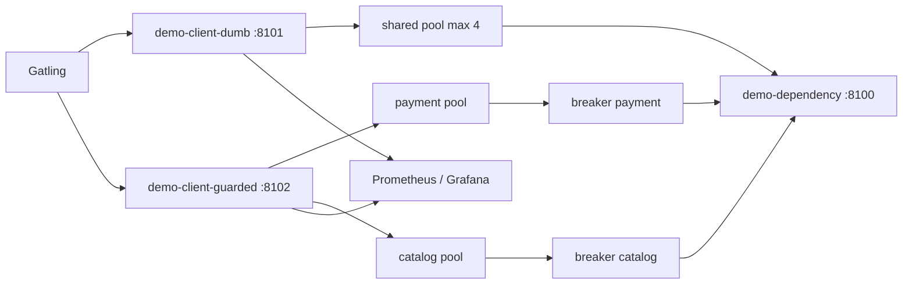

# circuit-breaker

## Проблема

Resilience4j в `bff-gateway` закрывает больную зависимость как библиотека. Снаружи видно fallback и метрики, но не сам автомат: когда окно считает slow-call, сколько проб выпускает half-open, почему один медленный payment не должен ронять catalog.

Без breaker'а на исходящих вызовах картина ещё жёстче. В WebFlux нет «пула потоков, который кончился» — есть **connection pool**. Checkout держит все слоты на медленном payment, browse к живому catalog стоит в pending acquire, p99 своей ручки раздувается. Зависимость «лежит медленно», а сервис отвечает всем плохо.

## Решение

Свой count-based circuit breaker в `circuit-breaker-starter` и демо из двух клиентов на одну зависимость:

| Клиент | Пул | Breaker | Что видно под slow payment |
|---|---|---|---|
| `demo-client-dumb` | один на payment+catalog, max 4 | нет | browse p99 растёт вместе с checkout |
| `demo-client-guarded` | два пула + два автомата | да | checkout → 503 после Open, browse остаётся быстрым |

Контрапункт к `load-shedding` из next-steps: shedding защищает себя от **входящих**, breaker — себя от **исходящих** к больной зависимости. Контрапункт к Resilience4j в BFF: те же пороги, видные кишки.



## Автомат

```
Closed → (failure rate OR slow-call rate ≥ threshold, calls ≥ min) → Open
Open   → (fail-fast 503) → через waitDuration → Half-open
Half-open → N проб: ниже порогов → Closed (окно сброшено)
          → иначе → Open (waitDuration заново)
```

Правила по умолчанию — как в BFF, плюс slow-call:

| Параметр | Значение |
|---|---|
| `slidingWindowSize` | 10 |
| `minimumNumberOfCalls` | 5 |
| `failureRateThreshold` | 50% |
| `slowCallRateThreshold` | 50% |
| `slowCallDuration` | 2s |
| `waitDurationInOpenState` | 5s |
| `permittedNumberOfCallsInHalfOpenState` | 3 |

Что считается исходом:

- **failure** — HTTP ≥ 500, таймаут, connect error. 4xx не failure (зависимость ответила).
- **slow** — длительность ≥ `slowCallDuration`, в том числе у 200 и у 4xx. Слот может быть и failure, и slow.
- **rejected** — Open / half-open без свободного пробного бюджета; downstream не вызывается.

Изоляция — по **имени команды** (`payment`, `catalog`) на атрибуте WebClient-запроса, не «весь хост». Один медленный payment не открывает catalog.

Состояние локальное на процесс. N реплик = N автоматов и N проб в half-open. Демо — по одному инстансу клиента.

## Модули

- `circuit-breaker-starter` — автомат, registry, `WebClientCircuitBreakerFilter`, Micrometer, Spring Boot autoconfig.
- `demo-dependency` — `/payment`, `/catalog`, `POST /control` (режимы `OK` / `ERROR` / `SLOW`).
- `demo-client-dumb` — общий пул, без breaker.
- `demo-client-guarded` — два пула, два breaker'а, Open → 503.
- `scripts/gatling` — cascade / isolated / side-by-side / error-trip.
- Prometheus + Grafana dashboard.

## Быстрый старт

```bash
# 1. Собрать jar'ы
./gradlew :circuit-breaker:demo-dependency:bootJar \
  :circuit-breaker:demo-client-dumb:bootJar \
  :circuit-breaker:demo-client-guarded:bootJar

# 2. Поднять стек
cd circuit-breaker && docker compose up --build -d

# 3. Grafana: http://localhost:3004  (admin / admin)
#    Dashboard: Circuit Breaker
#    Prometheus: http://localhost:9096

# 4. Нагрузка side-by-side (slow payment, оба клиента)
./gradlew :circuit-breaker:scripts:gatling:gatlingRun \
  --simulation=com.andver.circuitbreaker.gatling.SideBySideSimulation \
  --non-interactive
```

Ручное переключение зависимости:

```bash
# payment отвечает 3s (slow-call для breaker'а)
curl -s -X POST http://localhost:8100/control \
  -H 'Content-Type: application/json' \
  -d '{"paymentMode":"SLOW","delayMs":3000}'

# payment всегда 503
curl -s -X POST http://localhost:8100/control \
  -H 'Content-Type: application/json' \
  -d '{"paymentMode":"ERROR","errorRate":1.0}'

# обратно в норму
curl -s -X POST http://localhost:8100/control \
  -H 'Content-Type: application/json' \
  -d '{"paymentMode":"OK"}'
```

## Gatling

| Симуляция | Что показывает |
|---|---|
| `CascadeWithoutBreakerSimulation` | dumb: browse тонет вместе с checkout |
| `IsolatedWithBreakerSimulation` | guarded: checkout 503 после Open, browse жив |
| `SideBySideSimulation` | оба клиента сразу — главный демо-сценарий для Grafana |
| `ErrorTripSimulation` | trip по 5xx, не по latency; catalog остаётся CLOSED |

Параметры JVM (`-D`):

| Property | Default |
|---|---|
| `DURATION_SECONDS` | 45 |
| `CHECKOUT_RPS` | 20 |
| `BROWSE_RPS` | 20 |
| `PAYMENT_DELAY_MS` | 3000 |
| `DUMB_URL` / `GUARDED_URL` / `DEPENDENCY_URL` | localhost:8101 / 8102 / 8100 |

## Метрики

| Метрика | Смысл |
|---|---|
| `circuit_breaker_state{command}` | 0 CLOSED / 1 OPEN / 2 HALF_OPEN |
| `circuit_breaker_failure_rate` / `circuit_breaker_slow_call_rate` | % в текущем окне |
| `circuit_breaker_calls_total{command,outcome}` | success / failure / slow / rejected |
| `demo_request_duration_seconds{client,endpoint}` | latency своих `/checkout` и `/browse` |
| `reactor_netty_connection_provider_pending_connections` | очередь за слотом пула |

На дашборде смотреть: state over time, reject/slow rate, **browse p99 dumb vs guarded**, pending acquire.

## Тесты

```bash
./gradlew :circuit-breaker:circuit-breaker-starter:test
```

Без `Thread.sleep`: часы подменяются. Покрыты порог до `minimumNumberOfCalls`, open по failure и по slow 200, 4xx не failure, half-open бюджет под конкуренцией, 1/3 → Closed, 2/3 → Open, отмена пробы, in-flight из Closed не ест probe, фильтр в Open не подписывается на `ExchangeFunction`.

## Порты

| Сервис | Порт |
|---|---|
| demo-dependency | 8100 |
| demo-client-dumb | 8101 |
| demo-client-guarded | 8102 |
| Prometheus | 9096 |
| Grafana | 3004 |

## Стек

- Kotlin / Java 21
- Spring Boot 3 (WebFlux)
- WebClient filter / Reactor Netty connection pool
- Micrometer / Prometheus / Grafana
- Docker Compose / Gatling
