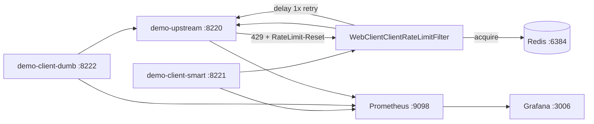

# client-rate-limiter

## Проблема

Сервер отдаёт квоту в заголовках (`RateLimit-*`, `X-RateLimit-*`, `Retry-After`), а клиент часто либо игнорирует их, либо делает «тупой» retry с фиксированной паузой. В итоге:

- лишние **429** и бесполезные повторы;
- параллельные реплики клиента **не делят** исходящий бюджет;
- локальный «не долби API» и уважение серверных заголовков живут отдельно.

Нужен клиентский слой: жёсткий распределённый потолок на исходящие вызовы + один осознанный retry по reset-заголовкам.

## Решение

**client-rate-limiter-starter** — Spring Boot starter для **WebClient**. На каждое matched-правило:

1. общий **token bucket в Redis** (жёсткий потолок на все реплики клиента);
2. при **429** — delay по заголовкам и **один** повтор внутри filter;
3. без usable reset-заголовков — **fail-fast** (429 наверх).

Демо сравнивает **smart** (starter) и **dumb** (fixed 50 ms retry без чтения заголовков) на одном mock upstream.



## Поведение filter

| Шаг | Действие |
|---|---|
| Match | yaml `path-prefixes`, ключ = имя правила |
| Cooldown | Redis `crl:cooldown:{rule}` — общий wait после 429 |
| Acquire | Lua token bucket `crl:token-bucket:{rule}`; нет токена → delay до refill (clamp `max-wait`) |
| HTTP | обычный exchange |
| 200 / др. | метрика `success` (или `recovered` после retry) |
| 429 + reset | wait → cooldown → acquire → **один** retry |
| 429 без reset | `fail_fast`, ответ 429 как есть |
| Повторный 429 | `fail_fast` |

`Remaining=0` на 200 **не** блокирует: клиент шлёт дальше и реагирует на 429 (как договорились).

### Приоритет wait после 429

1. `RateLimit-Reset` — **delta seconds**
2. `X-RateLimit-Reset` — unix epoch → delta (и сильнее `Retry-After`)
3. `Retry-After`
4. ничего → fail-fast

## Конфиг

```yaml
client-rate-limiter:
  enabled: true
  key-prefix: crl
  max-wait: 30s
  rules:
    - name: catalog
      path-prefixes: [/api/catalog]
      limit: 20
      window: 1s
      burst: 20          # 0 = равен limit
    - name: checkout
      path-prefixes: [/api/checkout]
      limit: 5
      window: 1s
      burst: 5
```

Длинный path-prefix побеждает короткий. Starter вешается на `WebClient.Builder` через `WebClientCustomizer`.

## Redis

| Key | Type | Назначение |
|---|---|---|
| `crl:token-bucket:{rule}` | HASH `tokens`,`ts` | исходящий token bucket |
| `crl:cooldown:{rule}` | STRING + TTL | общий post-429 wait |

## Модули

| Модуль | Роль |
|---|---|
| `client-rate-limiter-starter` | filter, Redis budget, header parser, metrics |
| `demo-upstream` | mock API: fixed window + `RateLimit-*` / `X-*` / `Retry-After` |
| `demo-client-smart` | starter ON, `/proxy/*`, `/load/*` |
| `demo-client-dumb` | fixed 50 ms retry, без чтения заголовков |

## Стек

- Kotlin / Java 21 / Spring Boot 3 (WebFlux)
- Spring Data Redis Reactive + Lua
- Micrometer / Prometheus / Grafana
- Docker Compose

## Метрики

| Метрика | Смысл |
|---|---|
| `crl_requests_total{rule,result}` | `success` / `rate_limited` / `recovered` / `fail_fast` / `budget_exceeded` |
| `crl_local_throttled_total{rule}` | ждали token bucket или cooldown |
| `crl_wait_seconds{rule,reason}` | `local` / `cooldown` / `header` |
| `crl_header_parse_errors_total` | битые заголовки |
| `crl_redis_errors_total{rule}` | сбой Redis |
| `crl_dumb_*` | сравнение на dumb-клиенте |
| `upstream_requests_total{result}` | allowed/rejected на upstream |

## Запуск

```bash
./gradlew :client-rate-limiter:client-rate-limiter-starter:test \
  :client-rate-limiter:demo-upstream:bootJar \
  :client-rate-limiter:demo-client-smart:bootJar \
  :client-rate-limiter:demo-client-dumb:bootJar

cd client-rate-limiter
docker compose up --build -d
```

| Сервис | URL |
|---|---|
| upstream | http://localhost:8220 |
| smart | http://localhost:8221 |
| dumb | http://localhost:8222 |
| Prometheus | http://localhost:9098 |
| Grafana | http://localhost:3006 (admin/admin) |

### Сравнение нагрузки

```bash
# smart: header-aware delay + Redis bucket
curl -X POST 'http://localhost:8221/load/checkout?requests=60&concurrency=20'

# dumb: fixed 50ms retry, заголовки игнорирует
curl -X POST 'http://localhost:8222/load/checkout?requests=60&concurrency=20'
```

Ожидание: у smart выше доля `ok`/`recovered`, меньше бесполезных 429 после retry; у dumb — много `naiveRetries` и `limited`. В Grafana дашборд **client-rate-limiter**.

Одиночный вызов:

```bash
curl -s http://localhost:8221/proxy/checkout | jq
curl -s http://localhost:8222/proxy/checkout | jq
```

## Out of scope

Circuit breaker, hedged requests, per-user ключи на клиенте, adaptive concurrency, RestClient/Feign, шаринг кода с `server-rate-limiter`, proactive sleep на `Remaining=0`.
