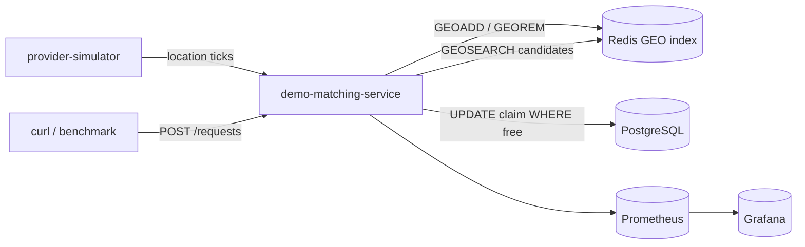

# geo-nearest-matching

Учебный проект: Redis только как GEO-индекс, статусы/requests в PostgreSQL, atomic claim в PG; без Kafka/UI/такси.

## Зафиксированные решения

- Фокус: учебный паттерн (как [cache-eviction](cache-eviction/README.md)), не продуктовый MVP.
- Домен: общий **provider** + **request** (точка + радиус), без такси/pickup/dropoff.
- **Redis — только GEO-индекс** (кто сейчас ищется и где). Никаких Hash со статусами/requests в Redis.
- **PostgreSQL — источник истины**: providers (status, last_seen, coords), requests.
- Assign: **atomic claim в PostgreSQL** (`UPDATE ... WHERE status = 'free'`), не Lua по Redis Hash.
- Без Kafka, без WebSocket UI, без surge/heatmap.
- Стек: Kotlin / Spring Boot 3 (WebFlux, R2DBC) / Redis / PostgreSQL / Micrometer / Prometheus / Grafana / Docker Compose.

## Разделение ответственности

| Слой | Хранит | Не хранит |
|------|--------|-----------|
| Redis GEO | member=`providerId`, координаты; в индексе только **free + fresh** | status, request, история |
| PostgreSQL | provider row, request row, claim | spatial search (медленнее для hot path) |

**Инвариант:** Redis — производный индекс от PG. Расхождение чинит sweeper/reconcile.



## Flow

### Location update

1. Upsert в PG: `lng`, `lat`, `last_seen_at`.
2. Если `status = free` и fresh → `GEOADD`; иначе `GEOREM` (не должен быть в индексе).

### Assign (atomic)

1. `GEOSEARCH` → упорядоченный список candidate ids + distance (только те, кто в индексе).
2. По порядку для каждого id:  
   `UPDATE providers SET status = 'busy', current_request_id = :rid WHERE id = :id AND status = 'free' AND last_seen_at > :cutoff RETURNING id`  
   — первый успешный row = claim.
3. Insert/update `requests` → `ASSIGNED` + `provider_id` + `distance_m`.
4. `GEOREM` claimed provider (busy больше не в индексе).
5. Если ни один UPDATE не затронул row → `NO_PROVIDERS` (гонка: кандидаты уже busy или stale).

Гонка двух requests на одного provider: второй `UPDATE` получает 0 rows → пробует следующего кандидата. Double-assign невозможен при корректном `WHERE status = 'free'`.

### Complete

1. Request → `COMPLETED`; provider → `free`, clear `current_request_id`.
2. `GEOADD` обратно в индекс.

### Stale

- Sweeper по PG: `last_seen_at` старше TTL → `offline`, `GEOREM`.
- Reconcile: busy/offline, но ещё в Redis → `GEOREM`; free+fresh, но нет в Redis → `GEOADD`.

## Компоненты

### `geo-matching-starter`

- `GeoIndex` (Redis): `add`, `remove`, `search(lng, lat, radiusM, count)` — только GEO API.
- `ProviderRepository` / `RequestRepository` (R2DBC): CRUD + `tryClaim(providerId, requestId, cutoff)`.
- `NearestAssigner`: search → loop tryClaim → update request → GEOREM; метрики.
- Конфиг: geo key, heartbeat TTL, default radius.
- Micrometer: `geo_search`, `assign_success`, `assign_conflict` (failed claim attempts), `no_providers`, `stale_evictions`, `location_updates`, `index_reconcile`.

### `demo-matching-service`

- REST: location, status, create request, complete, get request, `POST /benchmark/load`.
- Simulator: блуждание providers в bbox + тики location.
- Actuator + Prometheus.

### Infra

- `docker-compose.yml`: Redis, PostgreSQL, demo, Prometheus, Grafana.
- SQL migration: `providers`, `requests`.
- Dashboard: assign latency, conflicts, no_providers, location rate, stale/reconcile.

### Docs

- README: зачем GEO отдельно от PG; dual-write + reconcile; демо гонки.
- Сузить [next-steps](next-steps) `on-demand-dispatch` → `geo-nearest-matching`.
- Ссылка в корневом [README.md](README.md) после реализации.

## Схема PG (черновик)

```sql
providers (
  id TEXT PRIMARY KEY,
  status TEXT NOT NULL,          -- free | busy | offline
  lng DOUBLE PRECISION,
  lat DOUBLE PRECISION,
  last_seen_at TIMESTAMPTZ,
  current_request_id TEXT NULL
)

requests (
  id TEXT PRIMARY KEY,
  status TEXT NOT NULL,          -- pending | assigned | completed | no_providers
  lng DOUBLE PRECISION NOT NULL,
  lat DOUBLE PRECISION NOT NULL,
  radius_m DOUBLE PRECISION,
  provider_id TEXT NULL,
  distance_m DOUBLE PRECISION,
  created_at TIMESTAMPTZ,
  updated_at TIMESTAMPTZ
)
```

## Вне scope

Kafka, WebSocket/карта, Lua-claim по Redis Hash, scoring beyond distance, fleet zones, OSRM ETA, auth.

## Порядок реализации

1. Skeleton + compose (Redis + PostgreSQL).
2. Starter: GeoIndex + PG repos + NearestAssigner + метрики.
3. Demo API + sweeper/reconcile + complete.
4. Benchmark + Grafana.
5. README + next-steps + корневой README.

## Todos

- [ ] Создать geo-nearest-matching: gradle modules (starter + demo), docker-compose Redis/PostgreSQL/Prometheus/Grafana
- [ ] geo-matching-starter: Redis GEO index + PG claim (`UPDATE WHERE free`), Micrometer
- [ ] demo-matching-service: REST location/status/request/complete + stale sweeper + Redis/PG reconcile
- [ ] Simulator + POST /benchmark/load + Grafana dashboard
- [ ] README проекта; сузить next-steps; ссылка в корневом README
