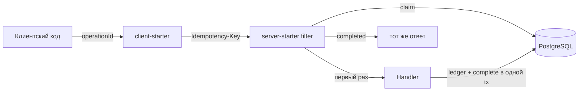

# idempotency-key

## Проблема

Клиент повторяет `POST` после таймаута или двойного клика. Без контракта на границе HTTP сервер выполняет мутацию снова.

Две частые ложные опоры:

- **`client-request-deduplicator`** кэширует только `2xx` на вызывающей стороне. Ошибки не помнит, два одновременных промаха оба уходят на сервер, после TTL запрос выполняется снова.
- **`idempotency_key` в outbox** генерирует продюсер. Консьюмер не применяет одно событие дважды, но повторный POST породит второе событие со вторым ключом. Клиент HTTP этот ключ не выбирает.

Нужен контракт, где клиент сам выбирает ключ операции, а сервер обещает: тот же ключ у того же владельца выполнит мутацию один раз и на любой повтор вернёт тот же ответ (включая бизнес-ошибку).

## Решение

Два стартера в одном проекте:

| Модуль | Роль |
|---|---|
| `idempotency-server-starter` | WebFilter + PostgreSQL: claim / replay / `409` / `422`, `complete` в той же R2DBC-транзакции, что и бизнес-запись |
| `idempotency-client-starter` | WebClient filter: стабильный `operationId` → один `Idempotency-Key` на все ретраи; повторяет таймаут и `409` |
| `idempotency-api` | Общие имена заголовков и статусы |



### Состояния записи

1. **started** — первый запрос вставляет строку с хешем тела и lease. Параллельный запрос с тем же ключом получает `409` + `Retry-After`.
2. **completed** — в той же транзакции, что и списание, сохраняются статус и тело ответа. Повтор читает эту строку, в том числе «insufficient funds».
3. **чужое тело** — тот же ключ, другой JSON: `422`, операция не выполняется.

Упали после commit — повтор безопасен (replay). Упали до commit — lease у `started` протухает, следующий запрос доделывает работу. Фильтр сам по себе не открывает бизнес-транзакцию: хендлер вызывает `IdempotencyCompleter.complete(...)` рядом со списанием.

### Клиент

```kotlin
webClient.post()
  .uri("/charges")
  .idempotent(operationId = "pay-42", owner = "alice")
  .bodyValue(ChargeRequest(10))
  .retrieve()
```

Один `operationId` → один ключ в памяти процесса. Новый UUID на каждый HTTP-вызов стартер не выпускает: иначе таймаут после успешного списания даёт вторую проводку.

## Демо

`POST /charges` списывает баланс в PostgreSQL. Два инстанса за nginx — блокировка в БД, не в JVM.

`demo-client`:

- `mode=starter` — держит ключ, ретраит таймаут/`409`
- `mode=naive` — новый UUID на каждую попытку

```bash
# сброс демо-счёта
curl -X POST 'http://localhost:8220/demo/reset?ownerId=alice&balance=100000'

# naive: после delay сервер уже списал, клиент получил timeout и ударил новым ключом
curl -s -X POST 'http://localhost:8223/demo/charge?mode=naive&delayMs=2000' \
  -H 'Content-Type: application/json' \
  -d '{"operationId":"op-naive-1","ownerId":"alice","amount":10}'

# starter: тот же сценарий — одна проводка, второй ответ = replay
curl -s -X POST 'http://localhost:8223/demo/charge?mode=starter&delayMs=2000' \
  -H 'Content-Type: application/json' \
  -d '{"operationId":"op-starter-1","ownerId":"alice","amount":10}'

curl -s 'http://localhost:8220/accounts/alice'
```

Gatling:

```bash
./gradlew :idempotency-key:scripts:gatling:gatlingRun \
  --simulation=com.andver.idempotency.gatling.ParallelSameKeySimulation --non-interactive

./gradlew :idempotency-key:scripts:gatling:gatlingRun \
  --simulation=com.andver.idempotency.gatling.BodyConflictSimulation --non-interactive
```

После параллельного прогона `GET /accounts/alice` показывает ровно одну проводку на ключ (плюс предыдущие, если не делали reset).

## Запуск

```bash
./gradlew :idempotency-key:demo-charge-service:bootJar :idempotency-key:demo-client:bootJar
cd idempotency-key && docker compose up --build
```

| Сервис | Порт |
|---|---|
| nginx → charge API | 8220 |
| demo-client | 8223 |
| PostgreSQL | 5437 |
| Prometheus | 9098 |
| Grafana | 3006 (`admin` / `admin`) |

## Конфиг

```yaml
idempotency:
  server:
    enabled: true
    lease: 30s
    retention: 24h
    max-body-bytes: 262144
    paths:
      - /charges
    owner-header: Idempotency-Key-Owner
  client:
    enabled: true
    max-retries: 5
    operation-ttl: 1h
    default-retry-delay: 200ms
```

## Метрики

- `idempotency_server_started` / `completed` / `replayed`
- `idempotency_server_conflict_in_progress` / `conflict_body` / `lease_taken_over`
- `idempotency_client_retries{reason}` / `idempotency_client_stop_unprocessable`

## Граница

Ключ закрывает вход HTTP. Внешний вызов до записи в БД он не прикрывает — тому вызову нужен свой ключ или outbox. Exactly-once вместе с Kafka здесь не обещается.

## Стек

Kotlin / Java 21 · Spring Boot 3 (WebFlux, R2DBC) · PostgreSQL · Micrometer / Prometheus / Grafana · Docker Compose / Gatling
