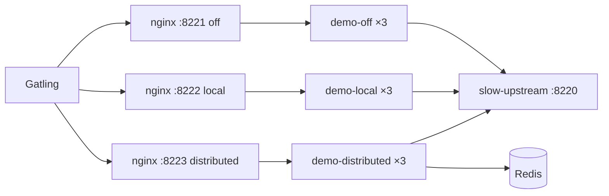

# singleflight

## Проблема

Горячий ключ (популярный `productId`) истёк в кэше или ещё не загружен. Сотни одновременных запросов уходят в upstream:

- **без coalescing** — каждый запрос = отдельный вызов (N × latency на базу/HTTP);
- **local singleflight** — внутри одного JVM схлопывается в 1 вызов, но при 3 репликах за балансировщиком снова до 3;
- **distributed** — один leader на весь кластер через Redis lease.

В `cache-eviction` уже есть process-local singleflight как деталь anti-stampede. Здесь — самостоятельный примитив: reactive API, политики ошибок, cross-pod режим и демо с Grafana.

Это **не** кэш с TTL (`client-request-deduplicator`), не idempotency-key и не waiting room. Запись живёт только пока запрос в полёте.

## Решение

**singleflight-starter** — `Singleflight.execute(key) { loader() }`.

| Mode | Где coalescing | Ожидание на hot-key burst (3 реплики) |
|---|---|---|
| `off` | нет | ~N upstream calls |
| `local` | JVM `ConcurrentHashMap` + `Sinks` | ~число реплик, которые получили трафик |
| `distributed` | Redis `SET NX PX` + result key | **1** upstream call |

Политики:

- `share-errors` — шарить 5xx на waiters или дать им re-elect;
- `waiter-timeout` — потолок ожидания;
- lease + failover — умерший leader не вешает waiters навсегда.



## Быстрый старт

```bash
./gradlew :singleflight:slow-upstream:bootJar :singleflight:demo-api-service:bootJar

cd singleflight
docker compose up -d --build
```

Проверка:

```bash
curl -i http://localhost:8222/products/42
# X-Singleflight-Role: LEADER|WAITER
# X-Singleflight-Mode: LOCAL

curl -X POST http://localhost:8220/admin/calls/reset
# параллельный burst одного id, затем:
curl http://localhost:8220/admin/calls
```

- Grafana: http://localhost:3016 (`admin` / `admin`) — dashboard **Singleflight**
- Prometheus: http://localhost:9108

## Gatling

```bash
./gradlew :singleflight:scripts:gatling:gatlingRun \
  --simulation=com.andver.singleflight.gatling.HotKeyBurstSimulation --non-interactive
```

Другие сценарии: `UniqueKeysSimulation`, `ErrorPolicySimulation`.

Ожидание на hot-key: в Grafana `sf_upstream_calls_total` по `mode` — `off` >> `local` >> `distributed` (~1 leader на burst).

## Конфиг

```yaml
singleflight:
  enabled: true
  mode: local          # off | local | distributed
  share-errors: true
  waiter-timeout: 5s
  namespace: demo
  distributed:
    lease: 10s
    result-ttl: 30s
    poll-interval: 25ms
```

## Тесты

```bash
./gradlew :singleflight:singleflight-starter:test
./gradlew :singleflight:singleflight-starter:integrationTest
```

## Структура

```
singleflight/
├── singleflight-starter/
├── slow-upstream/          # delay + call counter + /admin/fail
├── demo-api-service/       # GET /products/{id} через Singleflight
├── nginx/
├── prometheus/ grafana/
├── scripts/gatling/
└── docker-compose.yml
```

## Чем не является

| Паттерн | Отличие |
|---|---|
| `cache-eviction` singleflight | деталь кэша; здесь — отдельный starter + distributed |
| `client-request-deduplicator` | TTL-кэш **завершённых** 2xx |
| `idempotency-key` | контракт мутации, хранение ответа часами |
| `fifo-waiting-room` | очередь людей, не coalescing reads |

## Стек

Kotlin / Java 21 · Spring Boot 3 (WebFlux) · Spring Data Redis (Reactive) · Micrometer / Prometheus / Grafana · Docker Compose / Gatling
