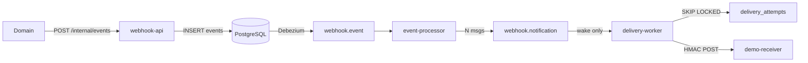

# webhook-dispatcher

## Проблема

Доменные сервисы должны уведомлять чужие HTTP endpoints о событиях (`order.paid` → `POST https://customer…/hooks`). Если делать это синхронно в том же запросе, accept latency и доступность зависят от чужого URL. Если слать HTTP прямо из Kafka consumer, один медленный endpoint держит partition и тормозит остальных подписчиков.

## Решение

Accept не ждёт чужой HTTP: `POST /internal/events` пишет строку в PostgreSQL и отвечает `202`. В Kafka строка попадает через Debezium (delivery outbox). `event-processor` делает fan-out: одно сообщение `webhook.notification` на подписчика, ключ `partitionKey:webhookId`. `signingSecret` в топик не пишется — worker читает его из БД перед POST (HMAC + `X-Idempotency-Key` + `X-Timestamp`).

HTTP не выполняется внутри Kafka consumer. Consumer только будит очередь `delivery_attempts`; claim через `SKIP LOCKED`, не больше 2 in-flight на webhook. Порядок сохраняется внутри `partitionKey + webhookId`. Retry — `next_attempt_at` с jitter (демо `3s → 8s → 20s`), не sleep в partition.



Политика ответов: **2xx** — успех; **5xx / timeout / сеть** — retry; **4xx** — сразу DLQ; **410** ещё и ставит endpoint на паузу. После N подряд транспортных ошибок — pause; resume и replay DLQ — отдельные API.

## Модули

| Модуль | Роль |
|--------|------|
| `webhook-core` | HMAC, SSRF, retry policy |
| `webhook-store` | R2DBC repos |
| `webhook-api` | регистрация + accept + ops |
| `event-processor` | fan-out без secret |
| `delivery-worker` | claim + outbound HTTP |
| `demo-receiver` | `/hooks/ok\|fail\|bad\|gone\|slow` |

## API (`:8240`)

```bash
# список seed-webhooks
curl -s -H 'X-Api-Key: demo-api-key' localhost:8240/webhooks | jq

# accept (идемпотентно по eventId)
curl -s -X POST localhost:8240/internal/events \
  -H 'Content-Type: application/json' \
  -d '{"eventId":"evt-1","tenantId":"ten_demo","eventType":"order.paid","partitionKey":"order-1","body":{"ok":true}}'

# статусы доставки
curl -s 'localhost:8240/deliveries?eventId=evt-1' | jq

# resume / rotate / replay
curl -s -X POST -H 'X-Api-Key: demo-api-key' localhost:8240/webhooks/wh-gone/resume
curl -s -X POST -H 'X-Api-Key: demo-api-key' localhost:8240/webhooks/wh-ok/rotate-secret
curl -s -X POST localhost:8240/deliveries/<id>/replay
curl -s -X POST -H 'X-Api-Key: demo-api-key' localhost:8240/webhooks/wh-bad/replay-dlq
```

Seed webhooks (`ten_demo` / `demo-api-key`):

| id | eventType | path |
|----|-----------|------|
| `wh-ok` | `order.paid` | `/hooks/ok` |
| `wh-fail` | `order.paid` | `/hooks/fail` |
| `wh-slow` | `order.paid` | `/hooks/slow` |
| `wh-bad` | `order.poison` | `/hooks/bad` |
| `wh-gone` | `order.gone` | `/hooks/gone` |
| `wh-ok-only` / `wh-slow-iso` | `order.isolated` | ok + slow (изоляция) |

## Стек

- Kotlin / Java 21
- Spring Boot 3 (WebFlux, R2DBC)
- PostgreSQL + Debezium CDC
- Apache Kafka
- Micrometer / Prometheus / Grafana
- Docker Compose / Gatling

## Запуск

```bash
./gradlew :webhook-dispatcher:webhook-api:bootJar \
  :webhook-dispatcher:event-processor:bootJar \
  :webhook-dispatcher:delivery-worker:bootJar \
  :webhook-dispatcher:demo-receiver:bootJar

cd webhook-dispatcher && docker compose up --build
```

| Сервис | Порт |
|--------|------|
| webhook-api | 8240 |
| event-processor | 8241 |
| delivery-worker | 8242 |
| demo-receiver | 8243 |
| Postgres | 5439 |
| Kafka (host) | 9094 |
| Debezium | 8084 |
| Kafka UI | 8089 |
| Prometheus | 9099 |
| Grafana | 3008 (`admin`/`admin`) |

## Демо-сценарии

1. **Happy path** — `eventType=order.paid` → `wh-ok` → `succeeded` (и retry у `wh-fail`/`wh-slow`).
2. **Idempotent accept** — повтор того же `eventId` → `200 duplicate`, одна строка в `events`.
3. **Изоляция** — `order.isolated`: `wh-ok-only` доставляется, пока `wh-slow-iso` ещё `in_flight`/`retry`.
4. **Poison 400** — `order.poison` → DLQ без pause.
5. **410** — `order.gone` → DLQ + `paused`; `POST .../resume`.
6. **Replay / rotate** — `replay-dlq`, `rotate-secret` + grace на receiver (`PUT /admin/secrets`).

Почему не HTTP в consumer: при sleep внутри listener медленный URL блокирует обработку partition. Здесь consumer только upsert attempt; HTTP — в отдельном claim-loop с cap и ordering gate.

## Gatling

```bash
./gradlew :webhook-dispatcher:scripts:gatling:gatlingRun \
  --simulation=com.andver.webhook.gatling.AcceptIdempotencySimulation --non-interactive

./gradlew :webhook-dispatcher:scripts:gatling:gatlingRun \
  --simulation=com.andver.webhook.gatling.IsolationSimulation --non-interactive
```

После IsolationSimulation: `GET /deliveries?eventId=…` — ok webhook `succeeded` раньше, чем slow закончит 10s delay.
